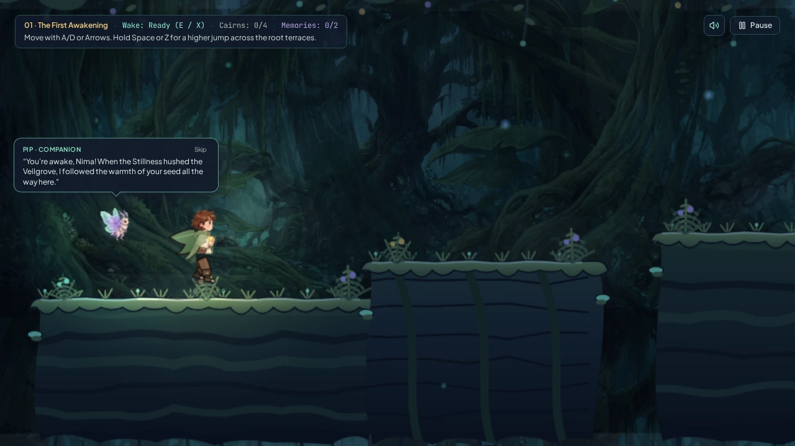
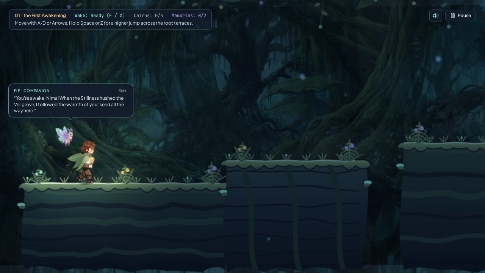
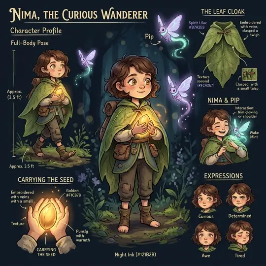
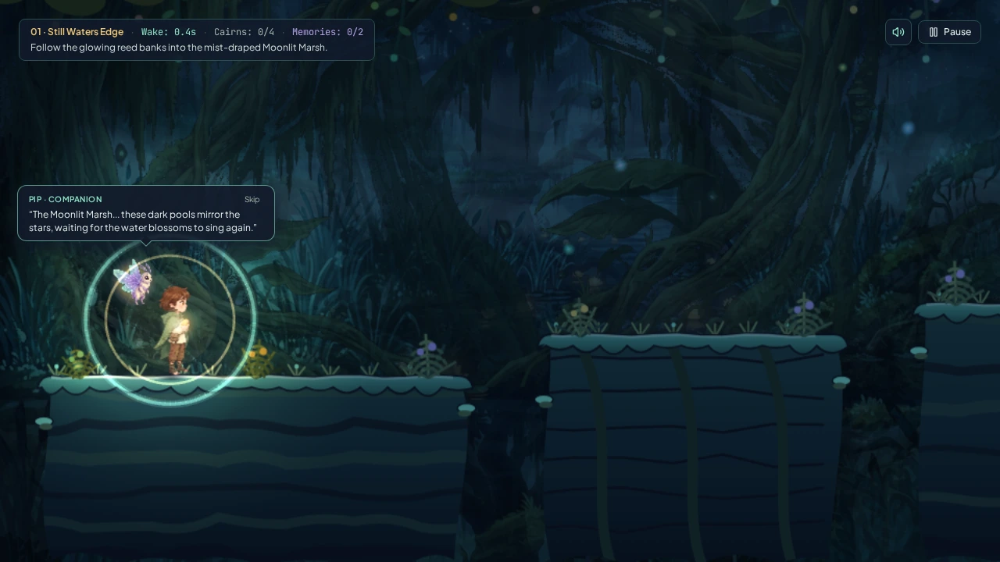
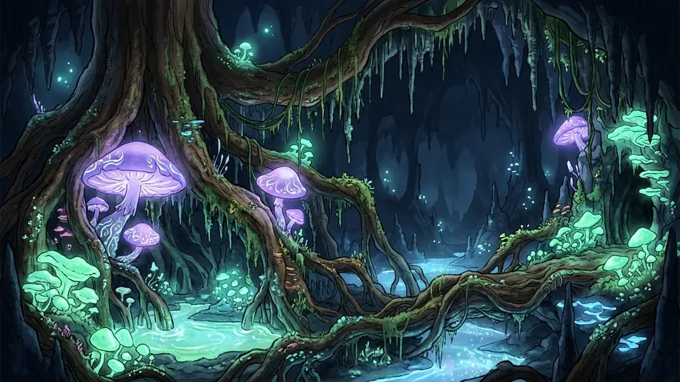
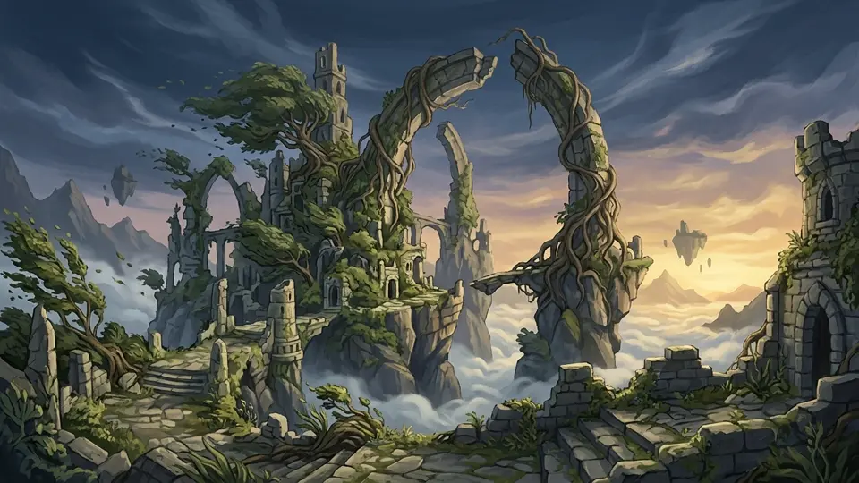

<div align="center">

# Wispwake — A Journey Through a Sleeping World

**A 2D Hand-Painted Cinematic Exploration Platformer Set in the Twilight Veilgrove**

[](./LICENSE)
[](./ASSET_LICENSE.md)
[](https://phaser.io/)
[](https://react.dev/)
[](./CONTRIBUTING.md)

<br />


</div>

---

## Overview

**Wispwake** is a 2D atmospheric exploration platformer where you guide **Nima**—a small forest traveler carrying a warm, living seed—and her bioluminescent moth companion **Pip** through the **Veilgrove**, an ancient tree-world hushed by a protective slumber known as the *Stillness*.

Instead of combat, Nima interacts with the sleeping ecosystem by releasing a radial pulse of **Wake**:
- **Sleeping Veil-Bells (`BloomPlatform`)** unfurl into temporary glowing leaf-pads.
- **Dormant Tendrils (`RootBridge`)** uncoil across chasms and remain permanently open.
- **Bioluminescent Drifters (`Drifter`)** amplify their glide across mist-filled gaps and carry Nima smoothly in 2D.
- **Resonance Cairns (`Checkpoint`)** ignite with golden sap light to anchor safe respawn points across each region.
- **Memory Echoes (`MemoryEchoNode`)** reveal hidden lore of the Seed-Keepers, Tide-Watchers, and First Choir.
- **Ancient Blooms (`AncientBloom`)** trigger a grand biome restoration that washes warmth and light across all six parallax layers.

---

## Visual Tour & Screenshots

| Title Screen (`PLAY`, `SETTINGS`, `CREDITS`) | Chapter 01 · The Sleeping Canopy |
| :---: | :---: |
|  |  |
| **Nima 10-Frame Biomechanical Run & Wake** | **Pip Companion Helper & Story Narration** |
|  |  |
| **Chapter 02 · The Moonlit Marsh & Currents** | **Circular Wake Pulse & Dynamic 2.5D Lighting** |
|  |  |

<div align="center">
  
</div>

---

## Key Features (Milestone 5 — The Complete Adventure)

- **Expanded Four-Chapter Story Campaign (`LevelRegistry.ts`, `levelData.ts`)**:
  - Every chapter spans `11,200–12,800` units with **10 distinct named sub-areas**, `23–27` organic platform formations, `4` Resonance Cairn checkpoints, and `2` optional secret **Memory Echoes**:
    1. **Chapter 01 — The Sleeping Canopy**: Twilight boughs, mossy root networks, and the First Bloom Sanctuary.
    2. **Chapter 02 — The Moonlit Marsh**: Reflective mist waters, **Water Current** streams, sunken bell shrines, and the Great Wetland Lotus.
    3. **Chapter 03 — The Hollow Below**: Subterranean giant root caverns, rhythmic **Spore Vents**, **Crumbling Surfaces**, **Falling Debris**, and the Root-Heart Chamber.
    4. **Chapter 04 — The Windward Ruins**: High-altitude carved sky arches, **Wind Updrafts & Gales**, crumbling sky-stones, and the Great Crown Bloom climax.
- **True Story & Wake Trials Difficulty System (`Easy`, `Medium`, `Hard`, `Extreme`)**:
  - Story Difficulty dynamically adapts Bloom active windows, crumbling ledge escape timers, Drifter speed, hazard density, and checkpoint spacing while keeping Nima's movement crisp and responsive.
- **Rebuilt Wake Trials & Simulation-Based Level Validator (`WakeTrialsGenerator.ts`, `TraversalSimulationValidator.ts`)**:
  - Generates `12–16` (`Easy`), `16–20` (`Medium`), `22–26` (`Hard`), and `28–36` (`Extreme`) segments across **15 curated segment archetypes**.
  - Verified by `TraversalSimulationValidator` using step-by-step kinematic jump trajectory integration (`dt = 1/60s`) and Route Graph BFS reachability proof.
- **Streamlined Menu & Combined Play Selection (`App.tsx`)**:
  - Clean 3-button Title Screen (`PLAY`, `SETTINGS`, `CREDITS`), unified **Story Journey + Wake Trials** selector, and **About Wispwake** modal with world lore, story summary, and GitHub link.

---

## Controls

| Action | Keyboard | Mobile / Tablet Touch | Gamepad |
| :--- | :--- | :--- | :--- |
| **Move Left / Right** | `A` / `D` or `Left` / `Right Arrow` | Bottom-Left Left / Right Buttons | Left Stick or D-Pad |
| **Jump (Hold for Height)** | `Space`, `Z`, `W`, or `Up Arrow` | Bottom-Right **Jump** Button | `A` / Cross (`Button 0`) |
| **Release Wake Pulse** | `E`, `X`, or `Enter` | Bottom-Right **Wake** Button | `X` / Square (`Button 2`) or `RB` |
| **Pause / Menu** | `Esc` | Top-Right **Pause** Button | `Start` |

---

## Quick Start, Verification & Development

```bash
# 1. Clone the repository
git clone https://github.com/rawsushies/wispwake.git
cd wispwake

# 2. Install dependencies
npm install

# 3. Start the development server (http://localhost:3000)
npm run dev

# 4. Run the Milestone 5 Automated Verification Suite (16 Campaign Configs + 200 Wake Trial Seeds)
npx tsx scripts/verifyMilestone5.ts

# 5. Run TypeScript type-checking & build for production
npm run lint
npm run build
```

---

## License

- **Source Code**: Licensed under the [MIT License](./LICENSE).
- **Visual Artwork**: Original project artwork in `src/assets/images/` is licensed under [CC BY-NC 4.0](./ASSET_LICENSE.md).
