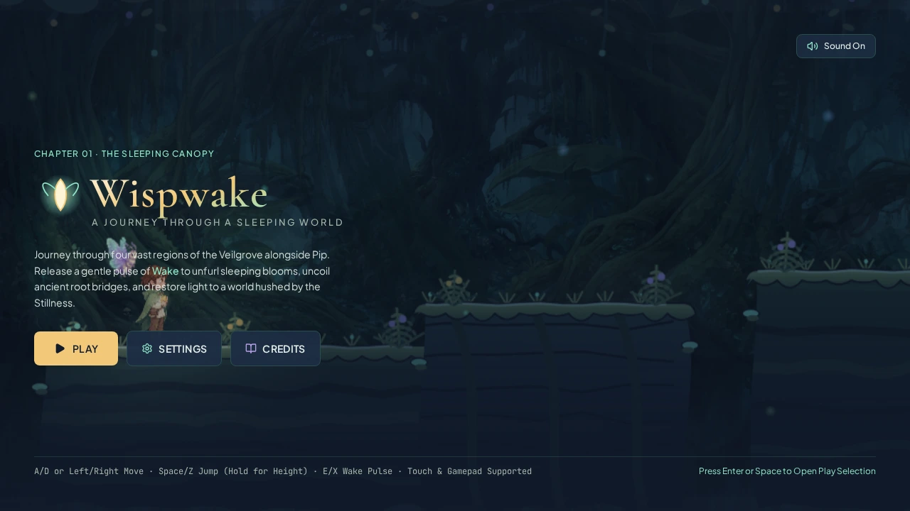

<div align="center">

# Wispwake — A Journey Through a Sleeping World

**A 2D Hand-Painted Cinematic Exploration Platformer Set in the Twilight Veilgrove**

[](./LICENSE)
[](./ASSET_LICENSE.md)
[](https://phaser.io/)
[](https://react.dev/)
[](./CONTRIBUTING.md)

<br />



</div>

---

## Overview

**Wispwake** is a 2D atmospheric exploration platformer—playable natively in both **Desktop Landscape (`16:9`)** and **Smartphone Portrait (`9:16` / `9:19.5`)**—where you guide **Nima**, a small forest traveler carrying a warm, living seed, and her bioluminescent moth companion **Pip** through the **Veilgrove**, an ancient tree-world hushed by a protective slumber known as the *Stillness*.

Instead of combat, Nima interacts with the sleeping ecosystem by releasing a radial pulse of **Wake**:
- **Sleeping Veil-Bells (`BloomPlatform`)** unfurl into temporary glowing leaf-pads.
- **Dormant Tendrils (`RootBridge`)** uncoil across chasms and remain permanently open.
- **Bioluminescent Drifters (`Drifter`)** amplify their glide across mist-filled gaps and carry Nima smoothly in 2D.
- **Resonance Bells (`ResonanceBellNode`)** ring out harmonic waves that awaken linked chains of distant Blooms.
- **Hostile Veilgrove Creatures (`EnemyManager`)**—Hushed Stalkers, Gloom Moths, and Rootbound Sentinels—are calmed and stunned by Nima's Wake pulse.
- **Friendly Veilgrove Dwellers (`NPCManager`)** share regional lore, quests, and entries in Nima's persistent **Story Journal**.
- **Ancient Blooms (`AncientBloom`)** trigger a grand biome restoration that washes warmth and light across all six parallax layers.

---

## Key Features (Milestone 6 — The Living Adventure + Native Portrait Mobile)

- **Native Portrait Smartphone Gameplay & Live Orientation Switching**:
  - Plays directly in portrait orientation (`9:16`, `9:19`, `9:19.5`, `320×568` through `430×932`) without requiring phone rotation.
  - Dynamically adapts the Phaser world viewport and camera anticipation in-place when rotating between portrait and landscape without resetting player position, velocity, checkpoints, or progression.
- **Six-Chapter Story Campaign (`LevelRegistry.ts`, `levelData.ts`)**:
  - Every chapter spans `11,200–12,800` units with **10 distinct named sub-areas**, `23–27` organic platform formations, `4` Resonance Cairn checkpoints, friendly NPCs, hostile creatures, and `2` optional secret **Memory Echoes** (`12` total):
    1. **Chapter 01 — The Sleeping Canopy**: Twilight boughs, mossy root networks, Oakhaven the Last Gardener, and the First Bloom Sanctuary.
    2. **Chapter 02 — The Moonlit Marsh**: Reflective mist waters, **Water Current** streams, Mirel the Tide-Watcher, and the Great Wetland Lotus.
    3. **Chapter 03 — The Hollow Below**: Subterranean giant root caverns, **Spore Vents**, **Crumbling Surfaces**, **Falling Debris**, and Thornwick the Rootkeeper.
    4. **Chapter 04 — The Windward Ruins**: High-altitude carved sky arches, **Wind Updrafts & Gales**, crumbling sky-stones, and the Great Crown Bloom.
    5. **Chapter 05 — The Shattered Choir**: Acoustic stone sanctuaries, **Resonance Bells**, Solen the Bellkeeper, and the Choir Heart Bell-Bloom.
    6. **Chapter 06 — The Heart of the Veil**: Golden Sap Rivers, combined environmental mastery gauntlets, and the First Seed Bloom finale.
- **Persistent Story Journal & Leaderboard (`StoryJournalManager.ts`, `LeaderboardManager.ts`)**:
  - 6-category **Story Journal & Bestiary** (`Story`, `Memories`, `Characters`, `Places`, `Creatures`, `Quests`) with 34 authored entries and spoiler-safe locked hints.
  - Integrated **Leaderboard** tracking completion time, respawns, restored nodes, and run scores across all 6 Story Chapters and procedural Wake Trials.

---

## Controls

| Action | Keyboard | Smartphone Portrait / Tablet Touch | Gamepad |
| :--- | :--- | :--- | :--- |
| **Move Left / Right** | `A` / `D` or `Left` / `Right Arrow` | Bottom-Left Left / Right Buttons | Left Stick or D-Pad |
| **Jump (Hold for Height)** | `Space`, `Z`, `W`, or `Up Arrow` | Bottom-Right **Jump** Button | `A` / Cross (`Button 0`) |
| **Release Wake Pulse** | `E`, `X`, or `Enter` | Bottom-Right **Wake** Button | `X` / Square (`Button 2`) or `RB` |
| **Speak with Character** | `F` | Contextual **Speak** Button | `Y` / Triangle (`Button 3`) |
| **Pause / Menu** | `Esc` | Top-Right **Pause** Button | `Start` |

---

## Quick Start & Verification

```bash
# 1. Install dependencies
npm install

# 2. Start the development server (http://localhost:3000)
npm run dev

# 3. Run TypeScript type-checking & build for production
npm run lint
npm run build
```

---

## License

- **Source Code**: Licensed under the [MIT License](./LICENSE).
- **Visual Artwork**: Original project artwork in `src/assets/images/` is licensed under [CC BY-NC 4.0](./ASSET_LICENSE.md).
