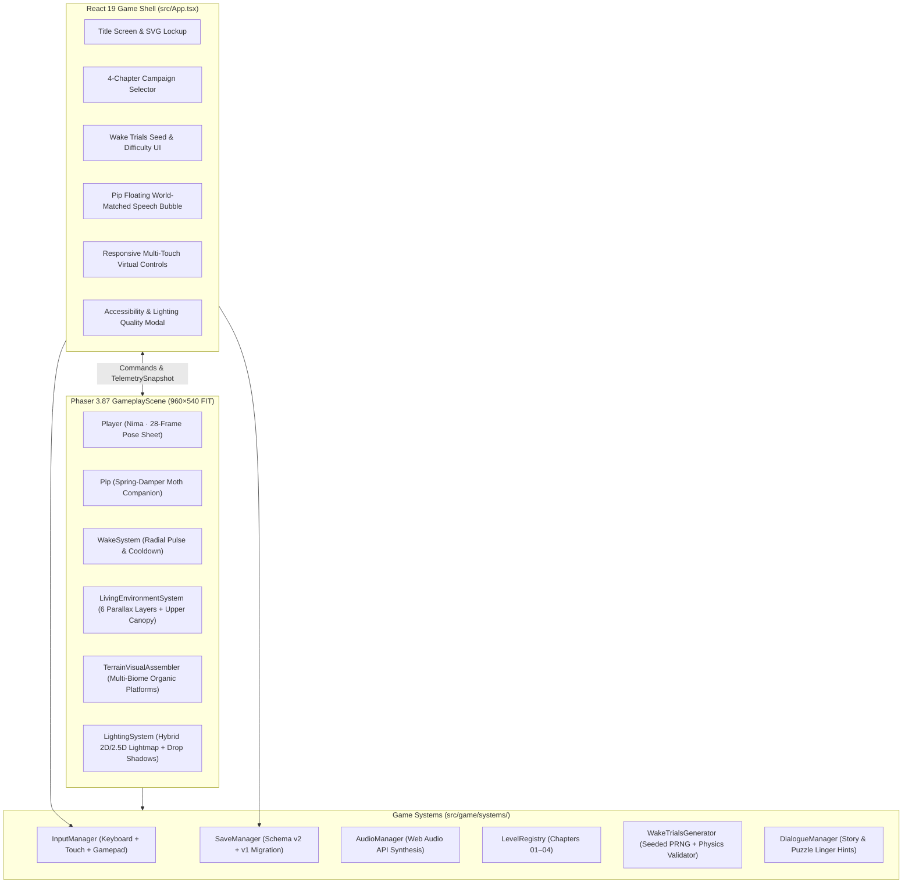

# Wispwake — Technical Architecture

**Wispwake — A Journey Through a Sleeping World** uses a decoupled **React 19 UI Shell + Phaser 3.87 Arcade Physics Engine** architecture designed for 60 FPS performance across desktop, tablet, and mobile browsers.

---

## 1. High-Level System Diagram

---

## 2. Core Subsystems

### 2.1 Character Art & Pose Pipeline (`src/game/systems/CharacterArtManager.ts`)
- **Nima (`nima_sheet`, 28 frames at `96×112`)**:
  - Uses chroma/luminance background keying (`extractCleanCharacterMatte`) on canonical hand-painted side-profile character art (`nima_side_gameplay_master`) and dedicated running contact/passing stride poses (`nima_run_contact_pose`, `nima_run_passing_pose`).
  - Synthesizes smooth 6-frame `idle`, 10-frame full-body `run`, 3-frame `jump`, 3-frame `fall`, 2-frame `land`, and 4-frame `wake` cast animations.
- **Pip (`pip_sheet`, 12 frames at `64×64`)**:
  - Pairs the keyed moth body with procedurally articulated, counter-rotating forewings and hindwings that flutter at `14–22 fps`.

### 2.2 Safe Physics & Checkpoint Respawn (`src/game/entities/player/Player.ts` & `Checkpoint.ts`)
- Nima's sprite is `96×112` with origin `(0.5, 0.5)` and an Arcade Physics body of `22×48` (`offset: 37, 40`), placing `body.bottom` at `sprite.y + 44`.
- `Player.getSafeCenterYForPlatformTop(platformTopY, 4)` guarantees `sprite.y = platformTopY - 48`, so Nima's feet always spawn `4px` cleanly above the solid platform top.
- `Player.respawnAt(safeX, safeY)` invokes `this.body.reset(safeX, safeY)`, zeroes velocity and acceleration, clears jump/coyote buffers, and enables `0.85s` of respawn hazard protection.

### 2.3 Six-Layer Living Environment & Upper Canopy (`src/game/systems/LivingEnvironmentSystem.ts`)
- **Layer 1 (`0.05x`)**: Biome master background plate (`canopy`, `marsh`, `cavern`, `ruins`).
- **Layer 2 (`0.14x`)**: Distant forest silhouettes and animated flocks of canopy birds.
- **Layer 3 (`0.26x`)**: Midground giant roots and mossy arches.
- **Layer 4 (`0.46x–0.82x`)**: Keyed near-environment twisted root archways, **Upper Canopy overhanging branch & blossom boughs**, swaying moss vines, and hovering bioluminescent wisps.
- **Gameplay Plane (`1.0x`)**: Separate static collision rectangles paired with multi-biome painted organic root/stone visuals (`TerrainVisualAssembler.ts`) and player-reactive surface ferns.
- **Layer 5 (`1.18x`) & Layer 6**: Foreground framing silhouettes, volumetric light shafts, drifting fog banks, and multi-depth spores.

### 2.4 Hybrid Dynamic 2D / 2.5D Lighting (`src/game/systems/LightingSystem.ts`)
- Projects soft multi-pass 2D directional drop shadows beneath platforms.
- Renders a real-time `MULTIPLY` offscreen lightmap (`320×180` scaled to `960×540`) that carves warm Sap Gold (`#F1C878`) and cool Wake Mint (`#8FE7C7`) radial illumination around Nima's seed, Pip, expanding Wake pulses, awakened flowers, checkpoints, and Ancient Blooms.
- Draws additive normal-style directional rim highlights along platform top surfaces when light sources approach.
